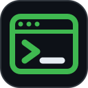

<p align="center"></p>

# browzat

Lets an AI agent (Claude Code or any other MCP client) drive **your own, logged-in browser profiles** in
Chrome, Edge and Firefox. Nothing is launched in a clean profile: the agent works in the browser you already
use, with your sessions, and you can watch it.

The project is published as **browzat**, and the extension shows that name and logo in the browser. Inside the code
it still uses its working name **Browser MCP** (`browser-mcp`): the folders, the MCP entry, the Firefox add-on id and
the environment variables keep that name, so existing installs and pairings keep working. The table below maps one
to the other.

## Names and locations

| What | Name or path |
|---|---|
| GitHub repository | `https://github.com/AnistoMejin/browzat` (private) |
| Source folder (clone, edit, commit here) | anywhere; on the original PC `C:\Entelegen\Projects\browser-mcp` |
| Install folder (what the browsers and the agent load) | Windows `%USERPROFILE%\.mcp-servers\browser-mcp`, Linux `~/browser-mcp` |
| Data folder (pairing token, `relay.log`, screenshots) | `~/.browser-mcp` (`%USERPROFILE%\.browser-mcp` on Windows) |
| MCP server name in Claude Code | `browser-mcp` (user level); tools appear as `mcp__browser-mcp__<tool>` |
| npm package name | `browser-mcp` (`package.json`, private, not published) |
| Extension name in the browser | **browzat** (was Browser MCP Bridge before 0.3.0); Firefox add-on id `browser-mcp-bridge@local` |
| Logo | `assets/logo.svg`; icons in `extension/icons/`, drawn by `assets/make-icons.py` |
| Relay address | `127.0.0.1:19789` |
| Environment variables | `BROWSER_MCP_PORT`, `BROWSER_MCP_HOME`, `BROWSER_MCP_TZ` |

Edit only the source folder. The installer copies it to the install folder; never edit the install folder by hand.

## Project structure

```
browzat/                         (source folder; the repository root)
├── README.md                    this file
├── CHANGELOG.md                 what changed in each version
├── SECURITY.md                  how to report a vulnerability; the security model
├── LICENSE                      MIT
├── package.json                 name, version (also used as the extension version), npm scripts, one dependency: ws
├── package-lock.json
├── .gitignore                   node_modules/, dist/, *.log, .env
├── .gitattributes               line endings: LF for install.sh, CRLF for install.ps1
├── .editorconfig                editor settings: UTF-8, 2-space indent, final newline
├── .github/workflows/ci.yml     CI: npm run check on Linux and Windows, Node 20 and 22
├── assets/
│   ├── logo.svg                 the browzat logo (README, GitHub)
│   ├── logo-256.png             the same as PNG
│   └── make-icons.py            draws the logo and the extension icons (Python + Pillow)
├── docs/research/               competitor landscape and the reference map of where others implement what
├── install.ps1                  Windows installer: copy → npm install → build → register MCP → restart relay → reload extensions
├── install.sh                   the same for Linux (not yet run on a real Linux machine)
│
├── server/                      Node.js side, runs on your computer
│   ├── common.js                shared settings: port, data folder, token file, logging helpers, relay start-up
│   ├── relay.js                 background daemon on 127.0.0.1; extensions connect over WebSocket (/ext),
│   │                            MCP processes call POST /rpc; mutual HMAC check of the pairing token
│   ├── mcp.js                   the MCP server the agent starts (stdio); defines the tools and forwards each call
│   └── cli.js                   start | stop | status | pair | reload | copy-token
│
├── extension/                   browser side, one codebase for all three browsers
│   ├── build.js                 builds dist/chromium (Manifest V3) and dist/firefox (Manifest V2)
│   ├── manifest.chromium.json   manifest template for Chrome and Edge
│   ├── manifest.firefox.json    manifest template for Firefox (adds containers and cookies permissions)
│   ├── icons/                   toolbar icons, 16 / 32 / 48 / 128 px
│   └── src/
│       ├── core.js              background logic: connect to the relay, pairing, run the tools it sends
│       ├── page.js              functions injected into web pages: snapshot, click, type, keys, wait
│       ├── sw.js                Chrome/Edge service-worker entry; loads page.js and core.js
│       ├── early.js             Firefox: starts the console recorder with each page, removes it from non-agent tabs
│       ├── popup.html           toolbar popup: profile name, relay port, manual token, Save and connect, Unpair
│       └── popup.js
│
├── test/                        tests and helpers (copied to the install folder too, so tests run there)
│   ├── check.js                 no-browser checks: JS syntax, JSON, build, manifest version (npm run check)
│   ├── e2e.js                   end-to-end test through the real MCP server against a local test page
│   ├── call.js                  call a single tool: node test/call.js <tool> '<json>'
│   ├── launch-firefox.js        throwaway Firefox with the add-on loaded (WebDriver BiDi)
│   ├── launch-chrome-pipe.js    throwaway Chrome with the extension loaded (DevTools pipe)
│   ├── launch-chromium.js       throwaway Edge / Chromium with the extension loaded
│   └── mac-sim/                 tiny add-on that imitates Firefox Multi-Account Containers for tests
│
└── .env                         local secrets such as a GitHub token (git-ignored; never commit)

Not in the source folder, made by the installer in the install folder:
  node_modules/                  the ws dependency (npm install)
  dist/chromium/, dist/firefox/  the built extensions that the browsers load (extension/build.js)
```

## How it works

It has three parts, all on your own computer:

| Part | What it does |
|---|---|
| Extension (`extension/`) | Runs in each browser profile and carries out the actions. One codebase, built twice: `dist/chromium` for Chrome and Edge, `dist/firefox` for Firefox. |
| Relay (`server/relay.js`) | A small background process on `127.0.0.1:19789`. The extensions connect to it. |
| MCP server (`server/mcp.js`) | What the agent starts. It forwards each tool call to the relay. |

```
agent  ──stdio──>  mcp.js  ──HTTP on 127.0.0.1──>  relay.js  <──WebSocket──  extension in each browser
```

## Requirements

- Node.js 20 or newer (22 or newer to run the test helpers).
- Chrome, Edge and/or Firefox.
- Claude Code is optional; the installer registers the server there if the `claude` command exists.

## Install

Clone this repository anywhere, then run the installer. Run it again after every `git pull`; it is safe to repeat.

```bash
git clone https://github.com/AnistoMejin/browzat.git
cd browzat
```

The repository is private, so cloning needs a GitHub login or a token with read access.

**Windows**

```powershell
powershell -ExecutionPolicy Bypass -File install.ps1
```

Installs to `%USERPROFILE%\.mcp-servers\browser-mcp`. Options: `-Dir <folder>`, `-Pair`, `-NoClaude`.

**Linux**

```bash
./install.sh
```

Installs to `~/browser-mcp`. Options: `--dir <folder>`, `--pair`, `--no-claude`.
No sudo is needed. If Node.js came without npm (Ubuntu's `apt install nodejs` does), the installer fetches the one
dependency, `ws`, straight from the npm registry at the version pinned in `package-lock.json` and checks its sha512.

On Ubuntu 23.10 and newer, AppArmor blocks the sandbox of Chromium builds that are not installed as system packages
(for example Playwright's Chrome for Testing): they exit with "No usable sandbox". Google Chrome, Chromium and
Firefox installed from the distribution's packages are not affected.
The Linux default is a visible folder because Snap and Flatpak browsers cannot read hidden folders in the home directory.

The installer does all of this:

1. checks Node.js,
2. copies the files to the install folder and installs the one dependency (`ws`),
3. builds both extension folders,
4. registers the MCP server in Claude Code as `browser-mcp` (user level),
5. restarts the relay and tells every already-loaded extension to reload itself with the new build.

### The one manual step: load the extension (once per browser profile)

Browsers do not let a program install an extension into a real profile, so this part is done by hand, once.
The installer prints the exact paths.

| Browser | Steps |
|---|---|
| Chrome | `chrome://extensions` → switch on **Developer mode** → **Load unpacked** → choose the `dist/chromium` folder of the install folder |
| Edge | `edge://extensions` → switch on **Developer mode** → **Load unpacked** → the same `dist/chromium` folder |
| Firefox | `about:debugging#/runtime/this-firefox` → **Load Temporary Add-on** → choose `dist/firefox/manifest.json` |

Notes:

- Chrome and Edge need the `chromium` folder. The `firefox` folder does not load there.
- Keep **Developer mode** on. Chrome and Edge disable unpacked extensions at the next start when it is off.
- Firefox removes a temporary add-on when Firefox closes, so load it again after each Firefox start. The pairing
  is kept. A permanent install needs the add-on to be signed by Mozilla, which this repository does not set up yet.

### Pair

```bash
node <install folder>/server/cli.js pair --open firefox,edge,chrome
```

This opens a pairing page in each browser; the extension picks up its token from it. No token is shown or typed.
For a specific Chrome or Edge profile add `--profile "Profile 1"` (the profile's folder name).
Pairing is needed once per browser profile.

### Give each profile a name

Two profiles of the same browser get the names `chrome` and `chrome-2` in the order they connect, so the names
can swap after a restart. Click the browzat icon in each profile, type a name such as `chrome-work`, and
press **Save and connect**. The name then stays with that profile.

## Tools

| Tool | Use |
|---|---|
| `status` | Which browsers are connected |
| `tabs` | `list`, `new`, `close`, `activate`; in Firefox also `containers` and `new` with `container` |
| `navigate` | Go to a URL, back, forward, reload |
| `snapshot` | Read the page as a compact text outline; interactive elements get refs such as `[e12]` |
| `click` | Click by ref or CSS selector; `double`, `button` (left, right, middle) |
| `type` | Fill a field, or choose an option of a select; `clear: false` appends; `submit` presses Enter |
| `press_key` | Enter, Escape, Tab, arrows, PageDown, `Control+a` and so on |
| `hover` | Move the mouse over an element (menus, tooltips) |
| `drag` | Drag one element onto another (HTML5 drag and drop, sortable lists) |
| `mouse` | Click, move, down, up or wheel at viewport coordinates (canvas, maps, sliders) |
| `upload` | Put local files into a file input, or into the chooser a button opens |
| `dialog` | Set the answer for the next alert / confirm / prompt |
| `network_requests` | List a tab's requests (filter by URL, type, failed); `bodies: true` starts recording response bodies |
| `network_request` | One request in detail: headers both ways, request body, response body |
| `network_route` | Block or mock requests by URL pattern; list, remove, clear |
| `network_conditions` | Chrome and Edge: offline, latency, slow download and upload |
| `console_messages` | Console output, uncaught errors, unhandled rejections, failed loads |

**Network and console:** requests are recorded in the tabs the agent opened (and in a tab of yours only after the
agent calls `network_requests` on it), at most the newest 500 per tab, in memory, dropped when the tab closes. URL
patterns are a substring, a glob with `*`, or `/regex/flags`. Response bodies are recorded only after
`bodies: true` (up to 1 MB each). Chrome and Edge show the debugging bar while bodies, routes or network conditions are
on. On Firefox, mocks keep the server's status code (Firefox cannot change it) and network conditions are not
available. The console on Chrome and Edge includes everything since the page started, even from before the agent
looked; on Firefox it covers pages opened or navigated in agent tabs.
| `evaluate` | Run JavaScript in the page |
| `wait_for` | Wait for text or a selector to appear or disappear |
| `screenshot` | Capture the visible part of a tab |
| `handoff` | Ask the user to do a step only a person can do (login, 2FA, passkey, captcha, a confirmation), then wait |

**Real input:** on Chrome and Edge, clicks, typing, keys, hover, drag and mouse actions go through the browser's
debugger API, so sites see them as real (trusted) input. The debugger attaches only while the agent acts and detaches
after 8 seconds idle; while attached, the browser shows a bar "browzat started debugging this browser". Firefox has no
debugger API for extensions, so there the input is simulated (most sites accept it; a few refuse simulated clicks).
Simulated input is also used inside iframes, when another element covers the target, and when DevTools is open on
the tab; the result says so.

**Dialogs:** in tabs the agent works in, alert / confirm / prompt never block the page. Alerts are accepted and
confirms and prompts are dismissed unless `dialog` set another answer before the action, and the action's result
lists every dialog that appeared.

**Handoff:** the tab comes to the front with a small card that shows the agent's message, the site, and **Continue**
and **Cancel**. The tool returns when you click one of them, when the tab closes, or after `timeout_s` (default 300,
at most 600). Only a real click counts: the page and the agent's own `click` tool cannot answer for you. The card
comes back if the page navigates (a login redirect, for example). While a handoff is open the toolbar icon shows `?`;
its popup lists open handoffs with the same two buttons, for pages where the card cannot be shown.

Tab handles look like `firefox:12`. The agent sees only the tabs it opened unless it asks for all tabs, and it
refuses to close a tab it did not open unless told to force it. Password field values are never included in a snapshot.

**Firefox containers (Multi-Account Containers):** `tabs` with `action: "containers"` lists them, and
`action: "new"` with `container: "Work"` opens a tab inside one. If the containers add-on reopens a site in its
assigned container, the tool follows it and returns the new tab.

## Day-to-day commands

Run these from the install folder.

| Command | What it does |
|---|---|
| `node server/cli.js status` | Relay state and connected browsers |
| `node server/cli.js start` / `stop` | Start or stop the relay (it also starts by itself with the first MCP call) |
| `node server/cli.js pair --open firefox,edge,chrome` | Pair browsers |
| `node server/cli.js reload all` | Make every connected extension reload itself from disk |
| `node server/cli.js copy-token` | Put the pairing token on the clipboard, for manual pairing in the extension popup |

Other MCP clients: register a stdio server with the command `node` and the argument `<install folder>/server/mcp.js`.

Data lives in `~/.browser-mcp` (`%USERPROFILE%\.browser-mcp` on Windows): the pairing token, `relay.log` and
screenshots in `output/`. Log times are IST; set `BROWSER_MCP_TZ` (for example `Europe/Berlin`) for another zone.
`BROWSER_MCP_PORT` and `BROWSER_MCP_HOME` change the port and the data folder; a changed port must also be
entered in each extension's popup.

## Updating

1. `git pull` (or edit the code). If extension files changed, raise `version` in `package.json`.
2. Run the installer again. It rebuilds, restarts the relay and reloads the loaded extensions.

Firefox, while it runs a temporary add-on, may need **Reload** pressed once in `about:debugging`.

## Security

Full model and how to report a problem: [SECURITY.md](SECURITY.md).

- The relay listens on `127.0.0.1` only.
- A 256-bit token is created on first start and stored in `~/.browser-mcp/token`. The extension and the relay
  each prove to the other that they know it (HMAC challenge in both directions) before any command is accepted.
- Requests coming from web pages are refused (Origin and Host checks), so a site you visit cannot use the relay.
- The extension can read and act on every site you are logged in to. Treat the token file like a password, and
  do not run this on a computer where other users or untrusted software share your account.

## Limits

- Clicks and key presses are simulated events, not real input. Most sites accept them; a few do not.
- `evaluate` in Chrome and Edge fails on sites whose security policy forbids `eval`. Reading, clicking and typing
  are not affected. In Firefox the code runs in the extension's content-script world; page variables are under
  `window.wrappedJSObject`.
- Chrome and Edge cannot capture a window that is covered or minimised, so `screenshot` brings it to the front first.
- Internal pages (`chrome://`, `edge://`, `about:`, the extension stores) cannot be read or driven.
- Only the top page is read by default; pass `frames: true` to `snapshot` to include iframes.

## Tests

`npm run check` needs no browser: it checks the syntax of every JavaScript file, parses every JSON file, builds the
extension and confirms the built manifests carry the package version. CI runs it on every push.

`test/e2e.js` drives a local test page through the real MCP server:

```bash
node test/e2e.js <browser-id>                 # throwaway profile
E2E_REAL=1 node test/e2e.js <browser-id>      # your real profile: never lists or closes your own tabs
E2E_CONTAINERS=1 node test/e2e.js firefox     # also test Firefox containers
```

Helpers that start a browser with a throwaway profile and the extension already loaded:
`test/launch-firefox.js` (WebDriver BiDi), `test/launch-chrome-pipe.js` (DevTools pipe; needed for Chrome, which
ignores `--load-extension`) and `test/launch-chromium.js` (Edge and Chromium). `test/call.js <tool> '<json>'`
calls a single tool. `test/mac-sim` is a small add-on that imitates Multi-Account Containers for the container tests.

Tested (0.4.0, 2026-11-21) with the full end-to-end suite:

| System | Browsers | Result |
|---|---|---|
| Windows 11, real profiles | Chrome 157, Edge 157, Firefox 160 | all checks pass |
| Ubuntu 24.04 server (Xvfb virtual display, throwaway profiles) | Chrome for Testing 159, Firefox 160.0.1 | all checks pass, repeated runs on fresh profiles |
| Ubuntu 24.04 | two Chromium profiles connected at once (`chromium`, `chromium-2`) | all checks pass on both |

On a server without a desktop, start a virtual display first (`Xvfb :99 &`, then `DISPLAY=:99`). A Chromium test
build there needs `CHROME_EXTRA_ARGS=--no-sandbox` for `test/launch-chromium.js` (see the AppArmor note above);
`FIREFOX_BIN` points `test/launch-firefox.js` at a Firefox that is not in the default Windows location.

## Uninstall

```bash
claude mcp remove browser-mcp -s user
node <install folder>/server/cli.js stop
```

Then remove the extension in each browser and delete the install folder and `~/.browser-mcp`.

## License

[MIT](LICENSE). Changes are listed in [CHANGELOG.md](CHANGELOG.md).
